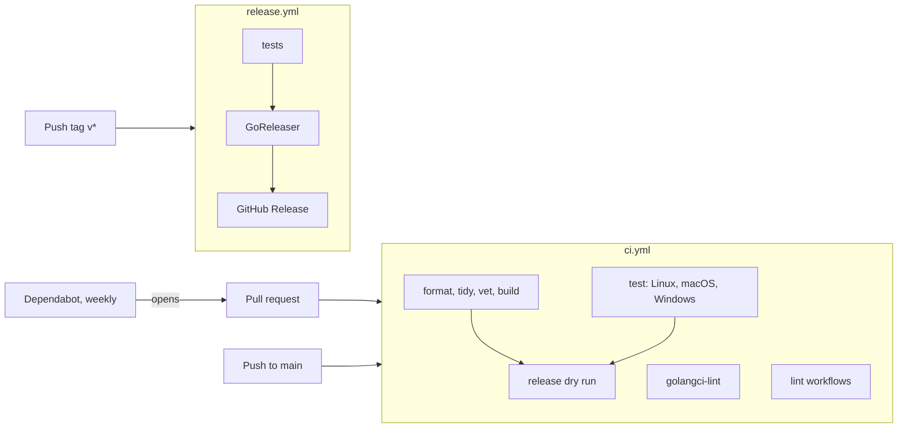

# CI/CD in this repo

How the GitHub Actions setup works, written while learning it. Every workflow
file is commented line by line; this page shows how the pieces fit together and
how to try each one.

- **CI** (continuous integration): every change is checked automatically before
  it reaches `main`.
- **CD** (continuous delivery): releasing is one command; the pipeline builds,
  tests and publishes.

## The pipeline



| File | Runs when | Does |
|---|---|---|
| `.github/workflows/ci.yml` | every pull request, every push to `main` | checks, tests on 3 OSes, lint, release dry run |
| `.github/workflows/release.yml` | a tag starting with `v` is pushed | tests, then publishes a GitHub Release with binaries |
| `.goreleaser.yaml` | used by both workflows | how to build, package and describe a release |
| `.github/dependabot.yml` | weekly | opens PRs that update Actions and Go modules |

## Concepts, and where each one is used

| Concept | What it means | Where to look |
|---|---|---|
| Workflow | A YAML file in `.github/workflows/` | `ci.yml`, `release.yml` |
| Trigger (`on`) | The event that starts a workflow | `pull_request`; `push` to `main`; `push` of a `v*` tag |
| Job | Steps that run together on one fresh machine; jobs run in parallel | `checks`, `test`, `lint`, ... |
| Runner | The machine a job runs on | `runs-on: ubuntu-latest` |
| Step | One shell command (`run`) or one Action (`uses`) | every job |
| Action | A reusable step someone published, pinned by version | `actions/checkout@v7` |
| Matrix | Run one job once per value | `test` runs on three OSes |
| `needs` | Make a job wait until other jobs pass | `release-dry-run` needs `checks` and `test` |
| `if` | Run a step only when a condition is true | race detector skipped on Windows |
| Contexts | Values available in `${{ }}` expressions | `matrix.os`, `runner.os`, `github.ref` |
| Permissions | What the run's token may do | read-only in CI; write only in the release job |
| `GITHUB_TOKEN` | A token made for each run that expires when the run ends | `release.yml` |
| Concurrency | Cancel an older run when a newer push arrives | `ci.yml` |
| Cache | Reuse downloads and builds between runs | done by `actions/setup-go` |
| Artifact | A file kept after the machine is thrown away | `coverage`, `binaries` |
| Step summary | Markdown shown on the run's page | the coverage line |
| Dependabot | A bot that opens dependency-update PRs | `.github/dependabot.yml` |

About pinning: `@v7` follows the latest v7 release of an Action, which is
convenient but trusts the Action's owner. The stricter option is pinning a full
commit SHA (`actions/checkout@<40-character sha>`); Dependabot can keep either
kind up to date.

## Try it yourself

1. **Watch a run.** Open a pull request and go to its **Checks** tab, or the
   repo's **Actions** tab. Click a job to see each step's log.
2. **Break something on purpose.** On a scratch branch, mis-indent a Go file
   and push. The `checks` job fails at "Check formatting". Run `gofmt -w .`, push
   again and watch it turn green.
3. **Download an artifact.** On a finished run's summary page, scroll to
   **Artifacts** and download `binaries`. Unpack the `darwin_arm64` archive and
   run `./wasitus version`. macOS blocks unsigned downloads; allow it with
   `xattr -d com.apple.quarantine wasitus`.
4. **Re-run a job.** Use "Re-run failed jobs" on a run's page. Handy when a
   step failed because of the network rather than the code.
5. **Cut a release.** On an up-to-date `main`:

   ```
   git tag v0.0.1
   git push origin v0.0.1
   ```

   Watch `release` in the **Actions** tab, then open **Releases**. To remove a
   practice release: `gh release delete v0.0.1 --cleanup-tag --yes` and
   `git tag -d v0.0.1`. While the repo is private, releases are visible only to
   people with access.

## Run the same checks locally

```
gofmt -l .                              # lists files that need formatting
go mod tidy -diff
go vet ./...
go test -race ./...
golangci-lint run                       # brew install golangci-lint
goreleaser release --snapshot --clean   # brew install goreleaser; output in dist/
```

## What the Windows tests caught

The first run of the three-OS matrix (PR #2) passed on Linux and failed on
Windows with four tests:

- **Line endings.** Git on Windows checks text files out with CRLF line
  endings. The three golden-file tests compare output byte for byte, so the
  expected files no longer matched. Fix: `.gitattributes` keeps LF on every OS.
- **What "absolute path" means.** `/abs/changes.yaml` is absolute on Linux and
  macOS, but Windows needs a drive letter, so the config treated it as relative
  and produced `\ignored\abs\changes.yaml`. Fix: the test builds its path with
  `t.TempDir()`, which is absolute everywhere.

Neither bug would have shown up on a Mac. That is the point of a matrix.
