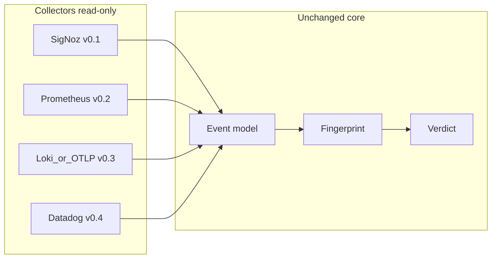

# Project plan

Owner: `alloteyphil` (personal project, personal GitHub)
Started: 26 Nov 2026
Target: v0.1 public release by end of January 2027

## 1. Why this project exists

**The problem.** During an incident, engineers open SigNoz, GitHub, the cloud
console and Slack in separate tabs and line up timestamps in their heads to answer
three questions: what broke, when, and *was it us?* Teams often blame the last
deploy by default, even when the cause was outside them: a provider outage, an
unpaid cloud bill, a rate limit, an expired certificate.

**The goal for the tool.** Given a time window, produce a single timeline and an
evidence-backed verdict on which side the cause sits.

**The goal for me.** A portfolio project that shows senior-level engineering:

- a real problem with a clear, narrow scope
- deliberate design, with written decisions (ADRs) and honest limitations
- production habits: tests, CI, releases, security and privacy by default
- a demo anyone can reproduce in about 10 minutes
- a write-up that explains the reasoning, not just the code

## 2. Ground rules

1. **No employer data, systems, credentials or time.** All development and testing
   uses the local demo lab (fake company, fake data). See
   [ADR-0002](adr/0002-own-data-only.md).
2. **Read-only and local.** The tool never writes to the systems it reads and never
   sends data anywhere. See [ADR-0003](adr/0003-read-only-local-first.md).
3. **Rules decide, AI only summarises.** See
   [ADR-0004](adr/0004-deterministic-verdict.md).
4. **Every verdict is tested.** Each staged scenario in [SCENARIOS.md](SCENARIOS.md)
   has a synthetic fixture (shaped like the lab, including cascades) and an
   expected verdict that CI checks.
5. **Scope discipline.** Anything not in the current milestone goes to the backlog.

## 3. Scope

### v0.1 (in scope)
- Command-line tool, single binary (Go)
- Sources: SigNoz (alerts, error traces, error logs, request rate), GitHub (merged
  PRs, deployments, releases), a local "changes file" for manual notes
- Error fingerprinting into causes: code, dependency, account/billing, rate limit,
  expiry, traffic
- Correlation and verdict with confidence and evidence
- Output: terminal table, Markdown report, JSON
- Redaction of personal data (phone numbers, emails, card numbers) in output, on by
  default
- Demo lab: small multi-service app + fake payment provider + local SigNoz, with
  scripts that stage each scenario

### Not in v0.1 (versioned in §5b / section 7)
Other observability backends (Prometheus, Loki/OTLP, Datadog), status-page feeds,
synthetic dependency probes, certificate-expiry scanning, AWS Health / CloudTrail,
AI summary, Slack output, MCP server, web UI.

## 4. Milestones

Time is in weekends (roughly 8–10 focused hours each). Estimates, not promises.

### M0: Foundations (started 26 Nov)
- [x] Create GitHub repo `alloteyphil/wasitus` (private until there is something
      to show; switch to public by M2), push the skeleton
- [x] CI: formatting, `go mod tidy`, `go vet`, `golangci-lint`, `go test -race`
- [x] `Event` model and `Window` type with unit tests
- [x] Config loading (YAML + secrets from environment variables) with validation
- [x] CLI skeleton: `wasitus version`, `wasitus timeline --from --to --config`
- [x] Changes-file collector (moved up from M2: it is local, needs no network, and
      makes the first slice real instead of fake)
- [x] Conventional commits, CHANGELOG.md, GitHub milestones M0–M5
- [x] CI green on the first pull request
- [x] CI/CD (added 26 Nov, to learn GitHub Actions; see docs/CI_CD.md): tests on
      Linux, macOS and Windows, workflow lint, release dry run on every PR,
      release workflow on `v*` tags (moved up from M5), Dependabot

**Done when:** CI is green and `wasitus timeline` runs end-to-end against the
example changes file.

### M1: The demo lab (weekend 2)
- [x] `demo/` Docker Compose: SigNoz + 3 small Go services (storefront, orders,
      wallet) instrumented with OpenTelemetry; `make lab-up` finishes SigNoz's
      first-run setup, and `make lab-smoke` (also in CI) proves traces arrive
- [x] `mockpay`: a fake external payment provider with switchable failure modes
      (healthy, outage, slow, suspended, rate-limited, expired cert); in Docker,
      wallet-service calls it over HTTPS so the expired cert really bites
- [x] Traffic generator (runs in the lab at 2 checkouts/s; rate changeable)
- [x] `demo/scenarios/run.sh` (`make scenario ID=S1..S8`, `make scenario-reset`)
      to stage and reset each scenario
- [x] Alert rules in SigNoz for error rate and latency (`demo/signoz/alerts/`,
      created by `make lab-up`)

**Done when:** `make lab-up && make scenario ID=S2` produces a visible incident in
the local SigNoz.

### M2: The timeline (weekend 3)
- [x] Spike: confirm which SigNoz API endpoints give alert history and query
      traces/logs (record findings in an ADR): docs/adr/0007-signoz-api.md
- [x] Collectors: SigNoz alerts, GitHub (PRs, deployments, releases)
- [x] Record/replay test harness: API responses saved to `testdata/`, replayed
      through `httptest` servers in CI
- [x] Merge, sort, de-duplicate; terminal table output

**Done when:** running against the lab shows the deploy and the alert in one
timeline, and the collector tests run offline.

### M3: Error fingerprinting (weekends 4–5)
- [x] SigNoz collector for error spans and logs (status, HTTP code, server address,
      exception type and message)
- [x] Rules engine: data-driven rules file (built-in defaults, user-overridable
      via `rules_file`)
- [x] Classify errors into causes, with share-of-errors per cause
- [x] Spike detection: 5-minute buckets compared with a 7-day baseline
- [x] PII redaction

**Done when:** each lab scenario's errors land in the expected cause class.

### M4: Correlation and verdict (weekend 6)
- [x] Candidate-cause scoring for changes (time proximity, same service, change type)
- [x] Verdict engine combining change candidates and fingerprint evidence
- [x] `UNKNOWN` when evidence is weak; confidence levels
- [x] Markdown and JSON output; golden-file tests
- [x] Scenario test suite: all scenarios in SCENARIOS.md pass from synthetic fixtures

**Done when:** 8/8 scenarios produce the expected verdict in CI.

### M5: Ship v0.1 (done 27 Nov 2026)
- [x] Tag v0.1.0 (the release pipeline already exists from M0) + Homebrew tap
      ([release](https://github.com/alloteyphil/wasitus/releases/tag/v0.1.0),
      [homebrew-wasitus](https://github.com/alloteyphil/homebrew-wasitus))
- [x] README with demo GIF and 10-minute quickstart against the lab
- [x] Design write-up / blog post: "Was it us? Telling our failures from someone
      else's" ([docs/writeups/was-it-us.md](writeups/was-it-us.md))
- [x] Add the project to the portfolio site (`../portfolio`)
- [x] Share draft: SigNoz/OTel community blurb
      ([docs/devlog/2026-11-27-v0.1-ship.md](devlog/2026-11-27-v0.1-ship.md))
      — posting is manual

**Done when:** a stranger can install it, run the lab, and reproduce a verdict
without asking me anything. Met for v0.1.0.

## 5. Timeline at a glance

| Weekend | Dates (approx.) | Milestone |
|---|---|---|
| 1 | 28–29 Nov | M0 Foundations |
| 2 | 5–6 Dec | M1 Demo lab |
| 3 | 12–13 Dec | M2 Timeline |
| 4–5 | 19 Dec – 10 Jan | M3 Fingerprinting (holiday slack built in) |
| 6 | 17 Jan | M4 Verdict |
| 7 | 24–31 Jan → **done early 27 Nov** | M5 Ship v0.1 |

## 5b. Version vision (after v0.1) — accessibility via more backends

v0.1 proved the thesis for a **narrow niche**: OTel/SigNoz + GitHub, deterministic
"our change vs external" verdicts, honest `UNKNOWN`. Most developers never touch
SigNoz. The lever for reach is **more observability backends** that still feed
the same `Event` → fingerprint → verdict pipeline
([ADR-0008](adr/0008-multi-backend-observability.md)).

Backends ship by **capability** (`alerts` / `errors` / `traffic`), not as
all-or-nothing SigNoz clones. One major backend path per minor version; fixtures
and synthetic scenarios before live demos.

| Version | Goal | Observability / evidence | Exit criteria |
|---|---|---|---|
| **v0.1** (shipped) | Prove the thesis | SigNoz (alerts+errors+traffic) + GitHub + changes file | Stranger installs and reproduces a verdict |
| **v0.2** | Reach Prometheus shops + cheap externals | **Prometheus + Alertmanager** (traffic + alerts); status-page JSON; cert/domain/token expiry checks; synthetic dependency probes | Non-SigNoz config documented; ≥1 traffic/alert scenario + ≥2 EXTERNAL scenarios green in CI |
| **v0.3** | Fingerprints without SigNoz | **Grafana Loki** and/or **OTLP/HTTP** error logs/spans (errors capability); Slack Markdown output | S2/S3-style EXTERNAL class from non-SigNoz errors in CI |
| **v0.4** | Commercial / cloud reach | **Datadog** collector (subset OK); AWS Health + CloudTrail | Datadog quickstart; S7-style red herring still passes with cloud noise |
| **v1.0** | Agent- and team-ready | Optional third backend (e.g. New Relic or Elastic) only if demanded; opt-in AI summary (cannot change verdict); MCP server | All prior scenario contracts still pass; summary cites evidence only |

**Why this order.** Prometheus is the widest free footprint for rates and alerts.
Logs/traces (Loki/OTLP) unlock account/limit/expiry classes without SigNoz.
Datadog unlocks companies that will never run a local SigNoz. Status pages and
expiry checks in v0.2 help every backend equally and are small PRs.

Hard rules that survive every version: read-only collectors, own-data lab, no
employer data, verdicts stay deterministic, AI never decides.

## 6. How I'll work (senior habits, visible in the repo)

- **Small PRs, even solo.** One feature per branch, PR description explains why.
  The history becomes part of the portfolio.
- **Decisions written down.** Any choice with trade-offs gets an ADR in `docs/adr/`.
- **Tests first for the logic.** Fingerprinting and verdict rules are table-driven
  tests; renderers use golden files; collectors use httptest fixtures shaped like
  the APIs.
- **Definition of done** for each task: tests, docs updated, CHANGELOG entry, CI
  green.
- **Weekly note** in `docs/devlog/` (5 lines: what shipped, what I learned, what's
  next). This feeds the blog post later.

## 7. Backlog (mapped to versions)

| Item | Target | Why it matters |
|---|---|---|
| Prometheus + Alertmanager collector (`alerts`, `traffic`) | v0.2 | Largest OSS footprint beyond SigNoz |
| Status-page feeds (Statuspage-style JSON) | v0.2 | Cheap external evidence for every backend |
| Certificate, domain and token expiry checks | v0.2 | Common EXTERNAL cause; backend-agnostic |
| Synthetic dependency probes | v0.2 | Provider outages with no status page |
| Grafana Loki and/or OTLP errors collector | v0.3 | Fingerprinting without SigNoz |
| Slack (or chat) Markdown output | v0.3 | Teams live there during incidents |
| Datadog collector | v0.4 | Commercial reach |
| AWS Health + CloudTrail collectors | v0.4 | Cloud outages and config changes |
| New Relic / Elastic (if demand) | v1.0 | Extra backend only when justified |
| AI-written incident summary (opt-in) | v1.0 | Post-incident draft; cites evidence only |
| MCP server mode | v1.0 | Agents call `wasitus` during investigations |

## 8. Risks

| Risk | Mitigation |
|---|---|
| Scope creep (it's a tempting problem) | Milestone exit criteria; backlog for everything else |
| SigNoz APIs change or are under-documented | Spike in M2; isolate behind the collector interface |
| Lab is heavy on RAM (SigNoz + services) | Keep lab services tiny; document minimum resources |
| Verdict looks smart on staged data only | Publish the scoring rules openly; include tricky scenarios (S7, S8) |
| Motivation dips mid-project | M2 already gives a working, demoable timeline |
| Employer IP questions | No employer data/time/systems (ADR-0002); optional conversation later |

## 9. Portfolio outcomes (fill in only when true)

CV bullet draft, to complete after v0.1:

> Designed and built **wasitus**, an open-source incident analysis CLI (Go) that
> combines OpenTelemetry/SigNoz signals with change history to tell
> self-inflicted outages apart from external ones; [N]/[N] staged incident types
> classified correctly; [stars / users / talks].
